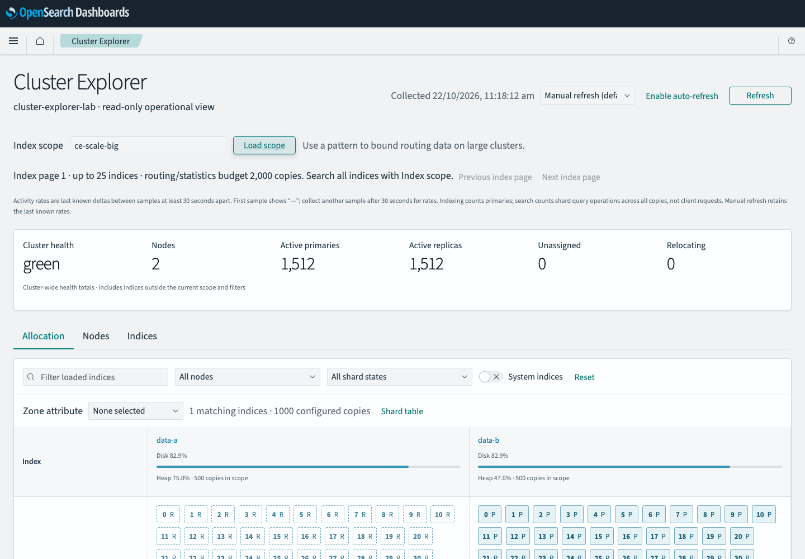
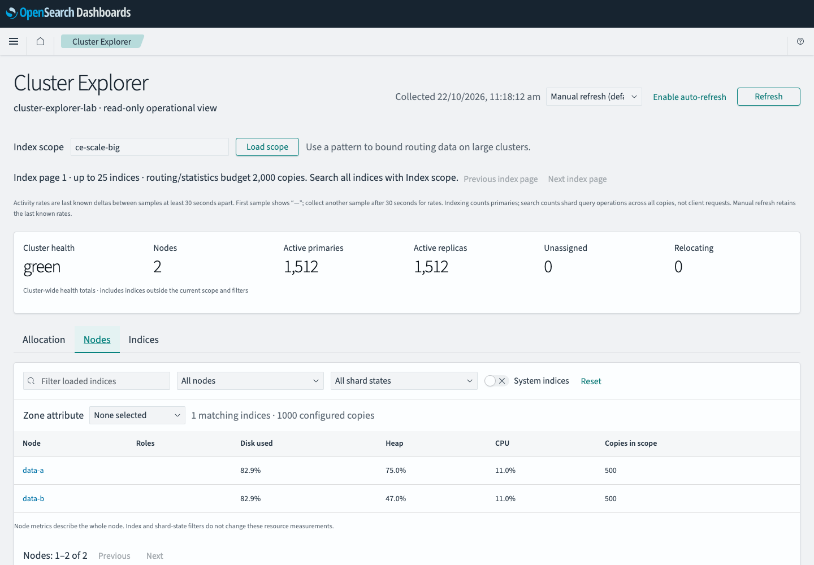
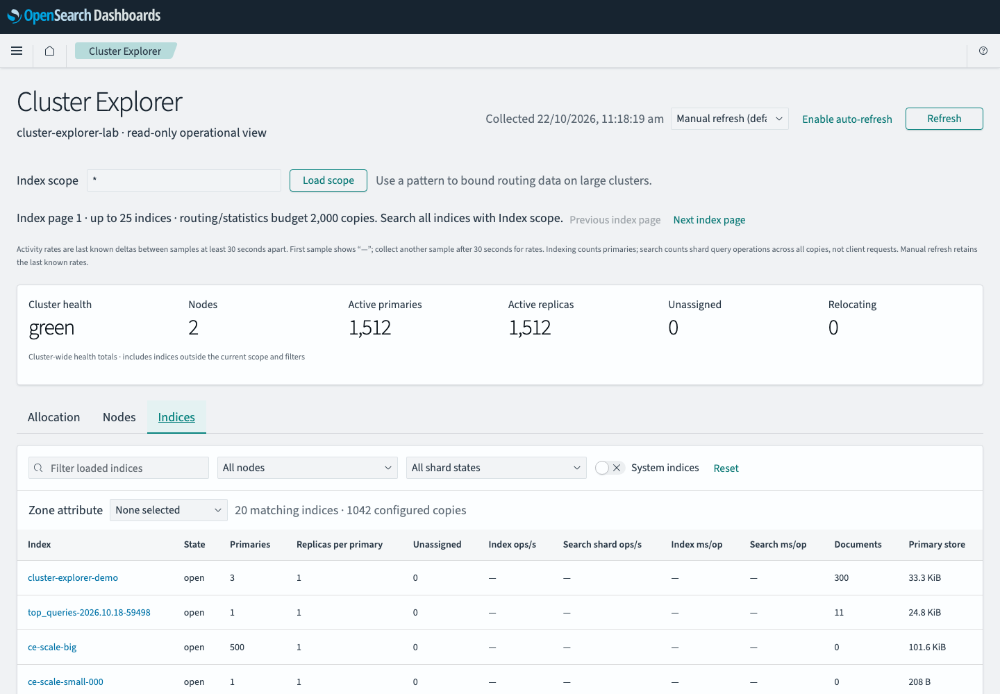
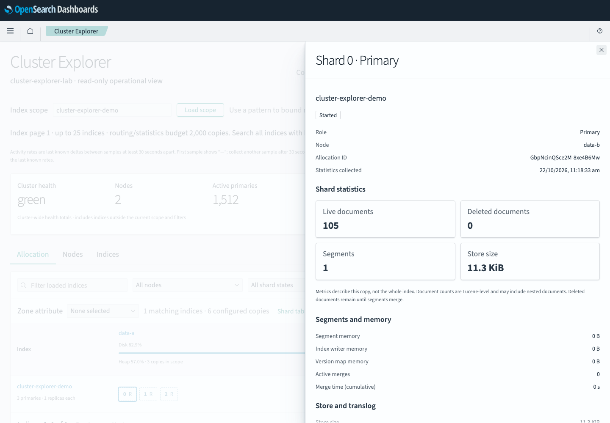
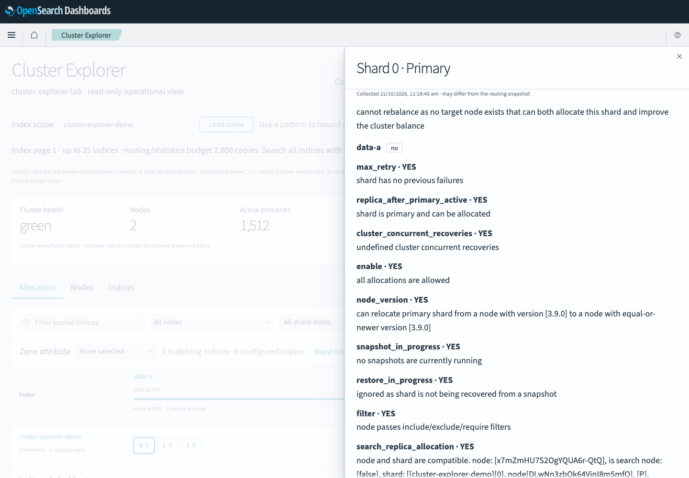

# Cluster Explorer

Read-only cluster operations plugin for **OpenSearch Dashboards 3.9.0**. Allocation, Nodes and Indices views use live OpenSearch data. Select a shard copy for document/segment counts, recovery and allocation decisions.

## Screenshots

These screenshots come from the local 3.9.0 lab, which has two nodes and 3,024 shard copies.



| Nodes | Indices |
| --- | --- |
|  |  |

| Shard details | Allocation explanation |
| --- | --- |
|  |  |

## Install

Initial preview: plugin **0.1.0**, for **Dashboards 3.9.0 only**. Install from the matching Dashboards installation, then restart:

```sh
bin/opensearch-dashboards-plugin install https://github.com/zaeemarshad/opensearch-cluster-explorer/releases/download/v0.1.0/clusterExplorer-0.1.0-opensearch-dashboards-3.9.0.zip
```

[Release downloads and SHA-256 checksum](https://github.com/zaeemarshad/opensearch-cluster-explorer/releases/tag/v0.1.0) · [Changelog](CHANGELOG.md). Open `/app/clusterExplorer`. To uninstall, run `bin/opensearch-dashboards-plugin remove clusterExplorer` and restart. Installation does not create roles or change cluster data.

To build from source against the matching Dashboards checkout:

```sh
scripts/bootstrap-dashboards.sh
scripts/build-plugin.sh
bin/opensearch-dashboards-plugin install file:///absolute/path/build/clusterExplorer-3.9.0.zip
```

Use Node 22 and Yarn 1.22.19. Restart Dashboards, then open `/app/clusterExplorer`. The scripts use `/private/tmp/cluster-explorer-dashboards-3.9.0` by default; set `DASHBOARDS_HOME` to use another matching checkout. Stop the development server before building in the same checkout.

## Permissions

Requests run as the signed-in user; the plugin creates no roles and stores no credentials or saved objects. See [Security](SECURITY.md) for the role template and authorization boundary. Dashboards Security remains responsible for authentication and application restrictions.

## Monitoring behavior

- Manual refresh by default. Automatic intervals start at 30 seconds; hidden tabs pause and failures back off.
- Index discovery is paged at 25 indices. Routing and statistics are limited to 2,000 configured copies per page; narrow the index scope for oversized pages.
- Per-process admission permits two active operations, a burst of four and one additional admission every five seconds. Busy requests receive HTTP 429. Multiple Dashboards processes multiply this budget.
- Rates require two samples at least 30 seconds apart. Indexing uses primary counters; search uses shard query operations across copies. Last known rates and their sample time stay in browser memory; reload clears history.
- Cluster health and node metrics are cluster-wide. Filters affect display, not authorization. Counts are Lucene counts and may include nested documents. Missing metrics stay unavailable.
- Routing is checked around detail requests; separate OpenSearch requests are not an atomic snapshot.

## Development and acceptance

```sh
npm ci --ignore-scripts --legacy-peer-deps
npm test
npm run typecheck:portable
npm run check:bundles
```

[Local setup and smoke tests](dev/SETUP.md) · [Submission checklist](SUBMISSION.md)

Report bugs through [GitHub issues](https://github.com/zaeemarshad/opensearch-cluster-explorer/issues), including host/plugin versions and steps to reproduce. See [contribution instructions](CONTRIBUTING.md).

Apache-2.0. Independent project; not an official OpenSearch release.
